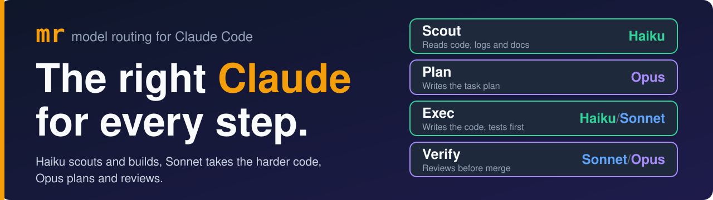
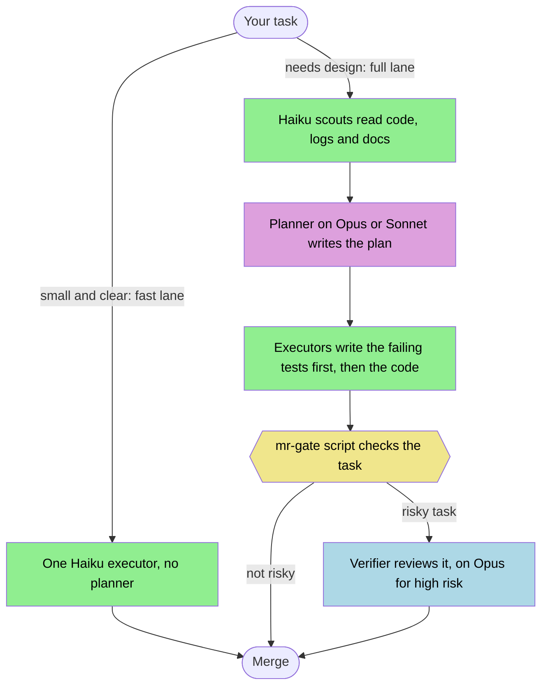
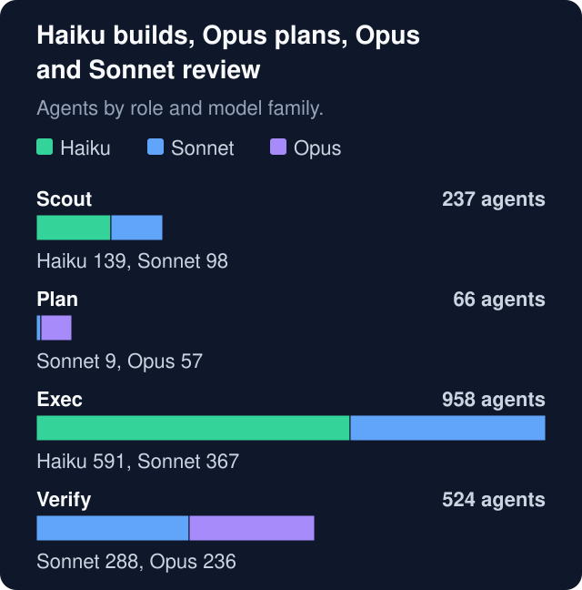
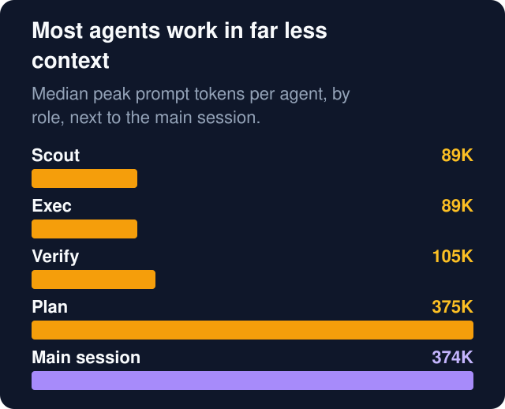
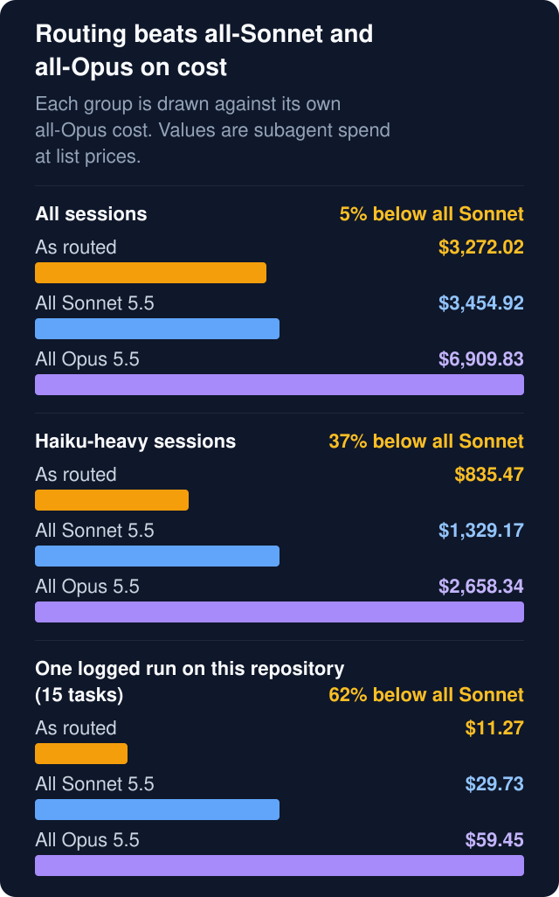
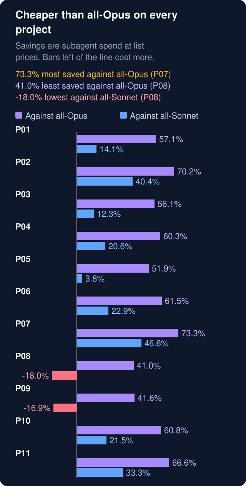

# mr: model routing for Claude Code

<p align="center">
  
</p>

### The right Claude for every step.

mr turns a Claude Code session into a team: Haiku scouts and builds, Sonnet takes the harder code, and Opus plans and reviews. Each agent starts with a fresh context, and a script checks every task before it merges.

[](LICENSE)
[](https://code.claude.com/docs/en/discover-plugins)
[](#requirements)

[Install](#install-the-plugin) · [Agents](#four-agents-four-jobs) · [Cost](#what-it-costs) · [Proof](#proof-across-11-projects) · [Hooks](#what-runs-on-your-machine) · [Commands](#commands)

<table>
  <tr>
    <td align="center" width="25%"><h2 align="center">18</h2>real projects, 1,785 agents</td>
    <td align="center" width="25%"><h2 align="center">37%</h2>below all-Sonnet when Haiku scouts and builds¹</td>
    <td align="center" width="25%"><h2 align="center">92%</h2>cheaper scouting on Haiku than on Sonnet¹</td>
    <td align="center" width="25%"><h2 align="center">4.2x</h2>smaller median context than the main session</td>
  </tr>
</table>

¹ Re-priced subagent spend, 42 sessions, 2026-10-27 to 2026-11-12, from the 11 projects with transcripts (Kotlin, TypeScript, Rust, Python, Swift, C#). [Study, data and method](docs/case-study.md).

## Install the plugin

Two commands, then a restart. You need Claude Code and `python3` 3.9 or later; [Requirements](#requirements) has the versions and platforms.

```sh
claude plugin marketplace add Alirezajalilii/claude-model-routing
claude plugin install mr@claude-model-routing
```

This installs at user scope, so the routing policy and the dispatch guard apply to every Claude Code session in every project, including the `/code-review` and `/simplify` limits described under [What runs on your machine](#what-runs-on-your-machine). To try it on one repository first, run the install from that repository with `claude plugin install mr@claude-model-routing --scope local`.

<details>
<summary>Other ways to install, and what to do if it fails</summary>

Claude Code 2.1.292 and later can do both steps in one command:

```sh
claude plugin install mr --marketplace Alirezajalilii/claude-model-routing
```

Inside a session, `/plugin install mr --marketplace Alirezajalilii/claude-model-routing` opens the plugin panel, so you can read what the plugin runs before you confirm (Claude Code 2.1.275 and later).

If `marketplace add` fails with an SSH error, Claude Code found an SSH key for github.com and tried SSH. Run the command again with `CLAUDE_CODE_PLUGIN_PREFER_HTTPS=1` in front of it, or pass the full URL `https://github.com/Alirezajalilii/claude-model-routing`.

</details>

Then restart Claude Code and set up each project you want to route:

1. Run `/mr:init-project` in the project. It creates `docs/plans/README.md` and `docs/model-routing-log.md` and adds a one-line pointer to the routing policy in your `CLAUDE.md`.
2. Add `CLAUDE_CODE_MAX_SUBAGENT_SPAWN_DEPTH` to the `env` block of `~/.claude/settings.json`, so that subagents cannot start subagents of their own:

   ```json
   { "env": { "CLAUDE_CODE_MAX_SUBAGENT_SPAWN_DEPTH": "1" } }
   ```

3. Ask Claude to run `mr-doctor`. It checks the setup above and prints a fix for anything that is off.

## Four agents, four jobs



Green runs on Haiku by default, blue on Sonnet, violet on Opus, yellow is a script.

| Agent | Runs on by default | What it does |
| --- | --- | --- |
| **Scout** | Haiku (Sonnet for deep cross-module digs) | Reads code, logs and docs, and writes the evidence the planner asks for. Read-only. |
| **Plan** | Opus (Sonnet for work in one module) | Writes the plan file: every task names the files it may touch, its Test Cases, its executor tier and a Gate block. |
| **Exec** | Haiku (Sonnet for harder code) | Commits the failing tests first, then the change that makes them pass. |
| **Verify** | Sonnet (Opus for high-risk work) | Reviews a finished task when the plan marks a risk such as authentication, payments, data integrity, migrations or security, when a task ran below its planned tier, or after a failed check. |

**Scouting goes to Haiku.** 139 of 237 scouts ran on Haiku, and the same scout tokens cost 92% less there than on Sonnet¹. By tokens, Haiku scouts carried 24% of the reading: the longest reads went to Sonnet more often.

- `mr-gate` checks that commits stay inside the task's files, that the new tests failed first and that the green commands pass.
- A Haiku executor that cannot finish hands the task to its planned Sonnet tier.

<details>
<summary>All tiers and how they are named</summary>

Tier agents are named `<role>-<model>-<effort>` with the roles `scout`, `plan`, `exec`, `verify`, and the main session dispatches them as `mr:<tier>`, for example `mr:exec-haiku-med`.

| Role | Tiers |
| --- | --- |
| scout | `scout-haiku-low`, `scout-haiku-med`, `scout-sonnet-high` |
| plan | `plan-sonnet-high`, `plan-opus-high`, `plan-opus-xhigh` |
| exec | `exec-haiku-low`, `exec-haiku-med`, `exec-haiku-high`, `exec-sonnet-med`, `exec-sonnet-high`, `exec-sonnet-xhigh` |
| verify | `verify-sonnet-med`, `verify-sonnet-high`, `verify-opus-high` |

The policy lives in `config/routing.json` and `policy/`; the `mr:routing-policy` skill holds the full text.

</details>

## The right model for each step

<p align="center">
  
</p>

**Every model does the work it is best at.** On Sonnet only, you lose Opus-level planning and review. On Opus only, you pay Opus rates for file edits and test runs. Here that came out as 57 Opus planners and 236 Opus verifiers on the steps that decide whether the work is right, and 591 Haiku executors on code a plan had already specified. The counts show where the work went, not the quality of the output.

## A fresh context for every stage

<p align="center">
  
</p>

**Each stage starts with a fresh context.** An executor starts from its task, not from the reading before it. I did not measure output quality, so I make no claim about it. What I measured: the median agent peaked at 89,877 prompt tokens, the median main session at 374,470, which is 4.2x larger. 11 of 42 sessions had at least one compaction. Planners are the exception: their median peak is 374,604 tokens.

## What it costs

<p align="center">
  
</p>

**Haiku scouts and builds: 37% below all-Sonnet and 69% below all-Opus.** `mr-cost` prices the same tokens at list prices on the models that ran, on Sonnet 5.5 and on Opus 5.5. A session is Haiku-heavy when more than half of its executors, and of its scouts if it had any, ran on Haiku: 24 of 42 sessions¹. With their main sessions added it is still 14% below all-Sonnet.

Across all 42 sessions, including those where executors stayed on Sonnet, subagent spend was 5% below all-Sonnet and 53% below all-Opus. In the 7 sessions where Sonnet ran most executors and Opus reviewed risky tasks, it was about 16% above all-Sonnet. Main sessions are left out of the first and last groups; their model is your choice.

<details>
<summary>The same numbers as a table</summary>

| Scope | Agents | As routed | All Sonnet 5.5 | All Opus 5.5 | Below all-Sonnet | Below all-Opus |
| --- | --- | --- | --- | --- | --- | --- |
| All sessions | 1,785 | $3,272.02 | $3,454.92 | $6,909.83 | 5% | 53% |
| Haiku-heavy sessions | 1,055 | $835.47 | $1,329.17 | $2,658.34 | 37% | 69% |
| This repository's run | 34 | $11.27 | $29.73 | $59.45 | 62% | 81% |

</details>

<details>
<summary>This repository's own run: 15 tasks, all on Haiku executors</summary>

One run on this repository (2026-11-11), priced with `mr-cost` at API list prices as of 2026-11-12, with 5-minute cache writes. Details in [docs/cost.md](docs/cost.md).

| Group | Agents | At the models that ran | Same tokens at Sonnet 5.5 | Same tokens at Opus 5.5 |
|---|---|---|---|---|
| scout | 7 | $0.48 | $8.86 | $17.72 |
| plan | 3 | $7.59 | $4.39 | $8.78 |
| exec | 15 | $0.80 | $14.08 | $28.16 |
| verify | 9 | $2.40 | $2.40 | $4.79 |
| total | 34 | $11.27 | $29.73 | $59.45 |

Limits of these numbers:

- They re-price one run's tokens; a Sonnet or Opus executor would have used a different number, so this is not a comparison of two runs.
- The main session is not included: `mr-usage` reads subagent transcripts only.
- Every subagent starts with roughly 15K tokens of fixed context when several hundred skills are installed, so routing costs more than it saves on a one-line edit.
- Haiku 5.5 bills prompts over 100K tokens at five times its base rate; this run's Haiku executors peaked at 91,105 tokens.

</details>

The [study](docs/case-study.md) has the method and what did not go well; a [deep dive](docs/case-study-monorepo.md) covers one large production run.

Price your own sessions:

```sh
mr-usage <session-id> --json | mr-cost -
```

`/mr:routing-report` collects the session id. If `ANTHROPIC_API_KEY` is set, Claude Code bills that key at API rates instead of your plan; `mr-doctor` tells you when it is set.

## More work per usage limit

**1.6x the subagent work per usage limit compared with all-Sonnet, in Haiku-heavy sessions¹.** This assumes the same work takes the same tokens on another model and that your plan meters usage in proportion to list price.

¹ Re-priced estimate of subagent spend: the same tokens at Anthropic API list prices with 5-minute cache writes. Reading it as usage-limit headroom assumes your plan meters usage in proportion to list price; Anthropic does not publish how it meters.

## Proof across 11 projects

<p align="center">
  
</p>

**Cheaper than all-Opus on every one of the 11 projects with transcripts: 41.0% to 73.3% less.** Against all-Sonnet, 9 saved between 3.8% and 46.6%, and 2 cost more: P08 by 18.0% and P09 by 16.9%. Figures are subagent spend at list prices.

## When mr is not worth it

- Single edits and quick questions: the main session is cheaper.
- Work you do not want to plan: the full lane writes a plan and a gate file for every task.
- Sessions that need `/code-review`, `/simplify` or other commands that start `general-purpose` agents.
- Windows machines (see [Requirements](#requirements)).

If your work is multi-step and testable, [install mr](#install-the-plugin) and run your next feature through it.

## What runs on your machine

| Event | Script | What it does |
| --- | --- | --- |
| SessionStart | `scripts/session_context.py --part 1` to `--part 5` | Adds the routing policy to the main session's context and warns about settings that override tier models or efforts. After a compaction only part 1 runs, as a pointer to the `mr:routing-policy` skill. |
| PreToolUse on `Agent`, `Task`, `Skill` | `scripts/dispatch_guard.py` | Blocks a subagent call that breaks the policy, for example a tier prompt without a `Skills:` line or an `Output:` path, a `model` or `effort` override, an agent type that is not a tier, or a subagent that tries to start another agent. Its messages start with `mr dispatch guard:`. |
| PreToolUse on `Read`, `Edit`, `Write`, `Grep`, `Glob`, `Bash`, `Skill` | `scripts/stall_watch.py` | Watches executors only. It nudges, then stops, an executor that repeats the same call or keeps reading without changing anything. Its messages start with `mr stall watch:`. |
| SessionEnd | `scripts/routing_audit.py --hook` | Writes an audit of the session (policy flags and the executor tier mix) to `audits/` in the plugin data directory. |

The scripts use the Python standard library and make no network requests. They read your Claude Code transcripts, skills and environment. They write to the plugin data directory and, when you run `mr-init`, to your project's `docs/` folder and `CLAUDE.md`. `mr-doctor` runs `claude --version`. `mr-gate` runs the commands written in a plan's Gate blocks, so read a plan before the main session gates it.

The dispatch guard denies every agent type that is neither a tier nor on its allowlist (`claude-code-guide` and `statusline-setup`). That includes `general-purpose` and `fork`, so commands such as `/code-review` and `/simplify` stop with a `mr dispatch guard:` message while the plugin is on. Turn the plugin off in `/plugin` when you need them.

## Commands

The plugin puts these commands on the PATH of Claude Code's Bash tool. Ask Claude to run them.

| Command | What it does |
| --- | --- |
| `mr-init [--claude-md]` | Creates `docs/plans/README.md` and `docs/model-routing-log.md` in the project; `--claude-md` also adds the policy pointer to `CLAUDE.md`. |
| `mr-doctor` | Checks Python, the Claude Code version, the settings the policy relies on, `ANTHROPIC_API_KEY` and the project setup. |
| `mr-usage <session-id>` | Model, effort and tokens for each subagent of a session; `--json` prints machine-readable rows. |
| `mr-cost <file>` or `mr-cost -` | Prices `mr-usage --json` rows at API list prices and re-prices the same tokens at Sonnet 5.5 and Opus 5.5 rates. |
| `mr-audit <session-id>` | Policy compliance flags for a session. |
| `mr-skills` | The skills inventory the planner uses to assign skills to tasks. |
| `mr-plan waves <plan>`, `mr-plan check` | Validates a plan's task contracts and prints the order the tasks can run in. |
| `mr-gate <plan> <task-id> <worktree> --commits <shas> --report <file> --out <file> [--base <rev>]` | Runs one task's gate and writes the gate file. |

Skills: `/mr:init-project` sets up a project, `/mr:routing-report` collects a session's routing evidence for `docs/model-routing-log.md`, and `mr:routing-policy` holds the full policy text.

## Requirements

- Claude Code. The plugin's behavior was checked on Claude Code 2.1.306 to 2.1.318; older versions are untested.
- `python3` 3.9 or later on macOS or Linux. The test suite passes on macOS and on Linux with Python 3.9. No packages to install.
- Windows is not supported. The hooks call `python3` and the commands depend on a `#!/usr/bin/env python3` line. WSL may work; I have not tested it.
- Planner agents use Claude Code's advisor tool. I have not tested a setup where it is unavailable.

## Update the plugin

```sh
claude plugin marketplace update
claude plugin update mr@claude-model-routing
```

Then restart Claude Code. Third-party marketplaces do not update on their own until you turn it on: run `/plugin`, open the **Marketplaces** tab, select this marketplace and choose **Enable auto-update**.

To pin a release, add the marketplace with a tag, for example `claude plugin marketplace add Alirezajalilii/claude-model-routing#v<version>`, where `<version>` is a release tag such as the latest one on the Releases page.

## Uninstall

The plugin data directory, `~/.claude/plugins/data/<plugin>-<marketplace>/`, holds your session audits, and `claude plugin marketplace remove` deletes it. Copy it somewhere first, then uninstall with:

```sh
claude plugin uninstall mr@claude-model-routing --keep-data
```

If you reinstall later, copy the audits back with `cp -Rpn <backup>/. ~/.claude/plugins/data/<plugin>-<marketplace>/`.

## Contributing

See [CONTRIBUTING.md](CONTRIBUTING.md). Maintainers: after installing from the pushed repository, run `make check-install` from a clean checkout of the same commit. It fails if the installed copy holds any file that is not committed.

## License

MIT. See [LICENSE](LICENSE).
