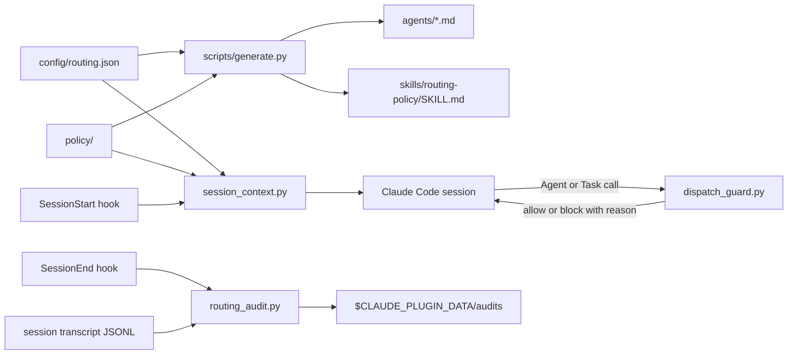

# Architecture — model-routing

## Context
model-routing is a Claude Code plugin for cost-aware model routing. It gives a dispatcher session tiered subagents (scouts, planners, executors, verifiers) on Haiku, Sonnet and Opus at chosen effort levels, injects the routing policy at session start, blocks delegations that break the policy, and writes a session audit. Users are developers who run Claude Code and install the plugin. Boundary: the plugin runs inside Claude Code and the user's own machine; it has no server, no database and no network component of its own.

## Components
There are no apps and no packages. The plugin is made of these parts:
- **Plugin manifest and marketplace** (`.claude-plugin/`): `plugin.json` (name, version 0.1.0) and `marketplace.json` (source `.`). Tech: JSON.
- **Hooks** (`hooks/hooks.json`, scripts in `scripts/`): SessionStart runs `session_context.py --part 1` to `--part 5` to inject the policy; PreToolUse on `Agent|Task` runs `dispatch_guard.py`; SessionEnd runs `routing_audit.py --hook`. Tech: Python 3.9+ standard library.
- **Config and policy** (`config/routing.json`, `policy/`): the single source of truth for tiers, roles, tunables and policy sections. `scripts/routing_config.py` loads and validates it; `scripts/policy_text.py` renders the policy text.
- **Generated agents and skill** (`agents/*.md`, `skills/routing-policy/SKILL.md`): produced by `scripts/generate.py`; never edited by hand. Owns no data.
- **Skills** (`skills/init-project`, `skills/routing-policy`, `skills/routing-report`): instructions Claude loads on demand. `init-project` copies `templates/` into a user project.
- **Commands** (`bin/model-routing-*`): launchers for `scripts/routing_audit.py`, `subagent_usage.py`, `skills_inventory.py` and `init_project.py`.
- **Transcript reader** (`scripts/transcripts.py`, `subagent_usage.py`): reads Claude Code session JSONL transcripts; reads only.
- **Data owned**: the session audit written under `$CLAUDE_PLUGIN_DATA/audits/`, outside the repository. `init-project` writes its two files into the user's own project, not into this repository.

## Data flow

## External services
- Claude Code (host runtime): loads the plugin, runs hooks, dispatches subagents.
- Anthropic models named in the tiers: Haiku, Sonnet and Opus, selected per subagent. The plugin calls no model API directly.
- No third-party APIs, storage or queues.

## Deployment
- Not deployed as a service. Distributed as a Claude Code plugin: users add the marketplace at this repository (`.claude-plugin/marketplace.json`, source `.`) or load it from a checkout.
- Built with `make build` (regenerates `agents/` and the reference skill). No container image (`infra/docker/` is empty).
- Released by semver tag per ~/Work/AGENTS.md section 10. Changes are recorded in CHANGELOG.md. No tags exist yet.
- No CI (`infra/ci/` is empty); checks run locally through `make lint` and `make test`.

## Key decisions
No ADRs yet: `docs/decisions/` holds only `0000-adr-template.md`. Decisions visible in the code and changelog, pending ADRs:
- Tiers and roles are data in `config/routing.json`; agent files are generated from it.
- The dispatch guard enforces policy at PreToolUse on `Agent|Task` rather than trusting the dispatcher prompt.
- No third-party Python packages (CONTRIBUTING.md).
